# FarmTech Solutions: visão computacional para o campo (vaca x trator)

[](https://www.python.org/)
[](https://pytorch.org/)
[](https://www.tensorflow.org/)
[](https://github.com/ultralytics/yolov5)
[](https://colab.research.google.com/)

**FIAP | Inteligência Artificial | Fase 6 | Projeto PBL**

| Nome | RM |
|------|----|
| Leticia Eltermann | 568645 |

> Um detector YOLOv5 treinado em 80 fotos rotuladas à mão encontra vacas e tratores no campo e nunca confunde um com o outro. Ele foi comparado com um YOLO pronto (COCO) e com uma CNN treinada do zero, e cada modelo foi auditado: onde erra, para onde olha e o quanto 8 imagens de teste conseguem provar de verdade.

## Sumário

- [Contexto](#contexto)
- [Onde está cada coisa](#onde-está-cada-coisa)
- [Destaques](#destaques)
- [Resultados em números](#resultados-em-números)
- [O que os modelos erraram e por quê](#o-que-os-modelos-erraram-e-por-quê)
- [Limitações](#limitações)
- [Extra: desafio vaca × cavalo](#extra-desafio-vaca--cavalo)
- [Vídeos de demonstração](#vídeos-de-demonstração)
- [Evidências do processo](#evidências-do-processo)
- [Estrutura do repositório](#estrutura-do-repositório)
- [Como executar](#como-executar)
- [Dataset e créditos](#dataset-e-créditos)
- [Tecnologias](#tecnologias)

## Contexto

A FarmTech Solutions está ampliando seus serviços de IA para a área de visão computacional. Este repositório reúne a prova de conceito apresentada a um cliente do agronegócio: um detector de objetos que reconhece **vacas** e **tratores** em imagens do campo, treinado com YOLOv5 em um dataset próprio e comparado com outras abordagens.


## Onde está cada coisa

Todo o desenvolvimento, as análises e as conclusões estão **nos notebooks**. Este README só apresenta os destaques e indica o caminho.

| Entrega | Conteúdo | Abrir |
|---------|----------|-------|
| Entregas 1 e 2 | Dataset, rotulação, YOLOv5 customizado (30 e 60 épocas), YOLOv5s padrão (COCO), CNN do zero e comparação | [Notebook principal](LeticiaEltermann_rm568645_pbl_fase6.ipynb) · [](https://colab.research.google.com/github/leticiael/leticiaeltermann-fiap-fase6-visao-computacional/blob/main/LeticiaEltermann_rm568645_pbl_fase6.ipynb) |
| Ir Além (opção 2) | Transfer learning com MobileNetV2 + fine tuning e segmentação automática para remover o fundo antes da classificação | [Notebook Ir Além](ir_alem/ir_alem_transfer_segmentacao.ipynb) · [](https://colab.research.google.com/github/leticiael/leticiaeltermann-fiap-fase6-visao-computacional/blob/main/ir_alem/ir_alem_transfer_segmentacao.ipynb) |

Atalhos para as seções do notebook principal: resumo executivo da Entrega 1 (logo no início), diagnósticos do YOLOv5 (5.4), análise de erros (6.4 a 6.6), *bootstrap* 30 x 60 épocas (6.8), Grad-CAM (11.8), comparação e análise crítica (12.1 a 12.12).

## Destaques

| | |
|---|---|
| **1. O detector acha e não confunde.** Nas 8 fotos de teste, o modelo `e60` encontrou 11 de 16 objetos com 1 alarme falso, e vaca e trator nunca foram trocados (seções 6.2 e 6.5).<br><br> | **2. Todo objeto perdido é pequeno.** As caixas perdidas ocupam em mediana 3,3% da foto, contra 58,5% das encontradas, e 100% delas estão em cenas com vários objetos (seção 12.3).<br><br>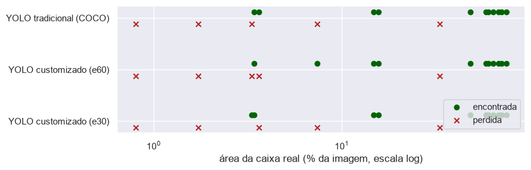 |
| **3. Resposta certa pelo motivo errado.** O Grad-CAM mostra a CNN do zero olhando para a máquina nos tratores, mas para o pasto ao redor de várias vacas (seção 11.8).<br><br>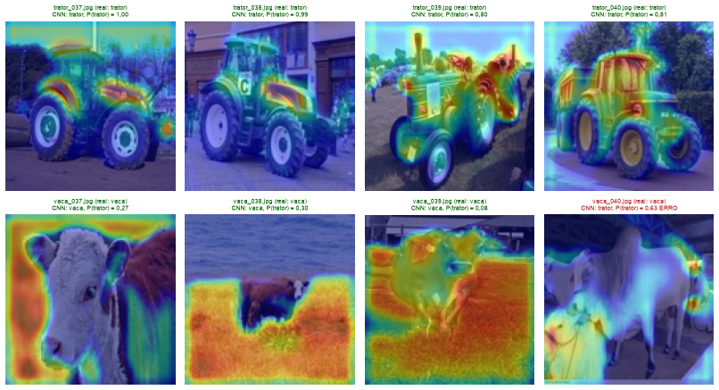 | **4. Latência no mesmo hardware.** Na CPU, a CNN do zero leva 28,6 ms por imagem contra 56,7 a 58,2 ms dos YOLO; na GPU, os três YOLO ficam entre 25,2 e 25,8 ms (seção 12.5).<br><br>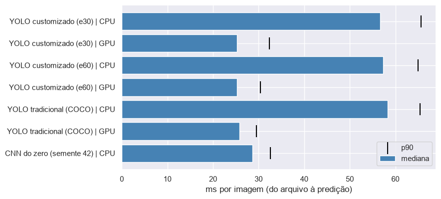 |
| **5. O que 8 imagens conseguem provar.** Mesmo um 8/8 tem IC 95% de 0,68 a 1, e uma abordagem precisaria acertar ao menos 6 imagens que a outra erra para a diferença ser significativa; nenhuma diferença entre abordagens foi (seção 12.4). Em val+teste, só estas 3 imagens derrubam alguma delas (seção 12.7):<br><br>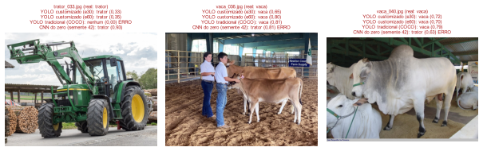 | **6. Ir Além: transfer learning e segmentação.** Na validação cruzada com as 80 imagens, a MobileNetV2 acertou 80/80 e a CNN do zero, 67/80; remover o fundo levou os erros da CNN do zero de 13 para 4 (McNemar p = 0,035).<br><br>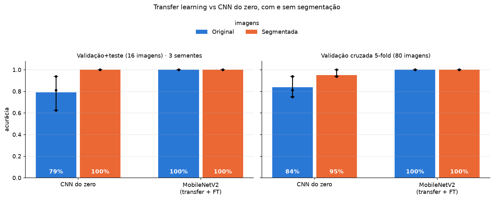 |

Diagnósticos completos do YOLOv5 (rótulos de treino, matriz de confusão, curvas PR e F1) estão na seção 5.4:

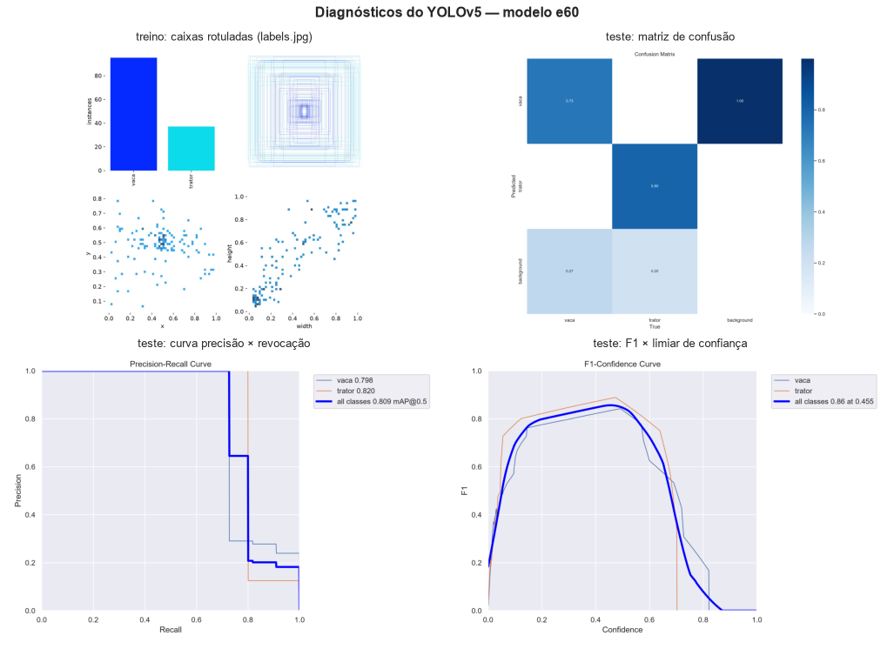

## Resultados em números

Todos os valores abaixo foram copiados das saídas geradas pelos notebooks executados.

**Entrega 1: YOLOv5 customizado, 30 x 60 épocas**

| Métrica | `e30` | `e60` |
|---|---|---|
| mAP50-95 na validação (critério de escolha) | 0,515 | **0,534** |
| mAP50 no teste | 0,785 | 0,809 |
| mAP50-95 no teste | 0,467 | 0,513 |
| Objetos encontrados no teste (conf ≥ 0,25, IoU ≥ 0,5) | 11 de 16 | 11 de 16 |
| F1 no teste | 0,815 | 0,786 |
| IoU médio dos acertos | 0,782 | 0,823 |
| Tempo total de treino | 2,7 min | 3,0 min |

Pelo *bootstrap* pareado (seção 6.8), a diferença de F1 não é detectável (IC 95% de -0,060 a +0,000), e o `e60` localiza melhor as caixas (IoU, IC 95% de +0,011 a +0,077). Modelo recomendado: **`e60`**.

**Entrega 2: três abordagens nas mesmas imagens**

| Abordagem | Acurácia por imagem, teste (IC 95%) | Acurácia val+teste | mAP50 no teste | Treino | Inferência CPU / GPU (ms/img) | Parâmetros |
|---|---|---|---|---|---|---|
| YOLO customizado (`e30` / `e60`) | 1,000 [0,68; 1,00] | 1,000 | 0,810 / 0,734 | 2,7 / 3,0 min (GPU) | 56,7 / 25,2 (e30) · 57,3 / 25,2 (e60) | 7.015.519 |
| YOLO tradicional (COCO) | 1,000 [0,68; 1,00] | 0,938 | 0,907 | 0 (pré-treinado) | 58,2 / 25,8 | 7.225.885 |
| CNN do zero (semente 42) | 0,875 [0,53; 0,98] | 0,875 | não se aplica | 0,6 min por semente (CPU) | 28,6 / não medida | 93.377 |
| CNN do zero (média de 5 sementes) | 0,975 (faixa 0,88 a 1,00) | 0,950 | não se aplica | 0,6 min por semente (CPU) | 28,6 / não medida | 93.377 |

O YOLO customizado exigiu anotar 152 caixas em 72 imagens; o tradicional e a CNN não exigiram anotação de caixas. A recomendação por cenário está na seção 12.12.

**Ir Além: quatro combinações (classificação)**

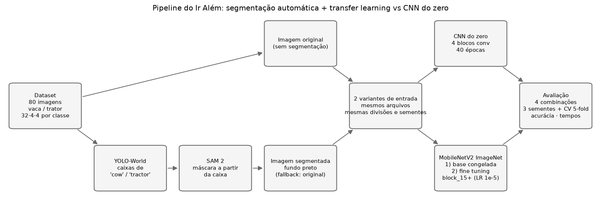

| Combinação | Val+teste, 16 img (média de 3 sementes) | Validação cruzada 5-fold, 80 img | Log-loss CV | Treino (s) | Inferência (ms/img) |
|---|---|---|---|---|---|
| CNN do zero · original | 79,2% | 67/80 = 83,8% | 1,259 | 58 | 8,7 |
| MobileNetV2 (transfer + fine tuning) · original | 100,0% | 80/80 = 100,0% | 0,002 | 35 | 41,7 |
| CNN do zero · segmentada | 100,0% | 76/80 = 95,0% | 0,132 | 57 | 9,1 |
| MobileNetV2 (transfer + fine tuning) · segmentada | 100,0% | 80/80 = 100,0% | 0,002 | 34 | 39,5 |

A segmentação automática (YOLO-World + SAM 2) gerou máscara para 80 de 80 imagens, sem nenhum *fallback*.

| Segmentação automática | Qualidade das máscaras |
|---|---|
| 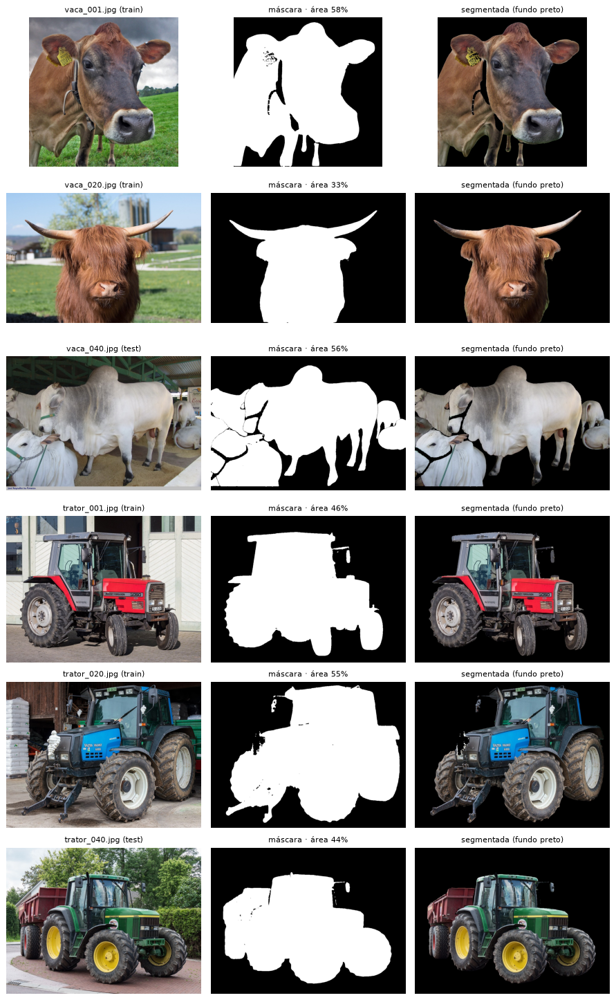 | 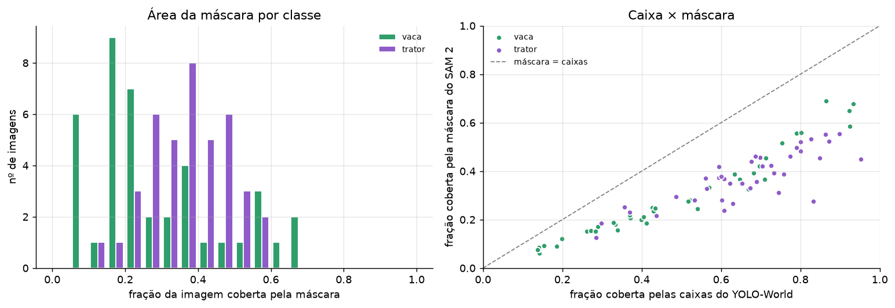 |

## O que os modelos erraram e por quê

- **Objetos pequenos em rebanhos.** Os 5 objetos que o YOLO perde são caixas pequenas em fotos com vários objetos; mais épocas não resolvem, mais exemplos de rebanho sim (seções 6.6 e 12.3).
- **O "trator" do COCO é um caminhão.** O COCO não tem a classe trator; nas imagens de trator, quem respondeu foi `truck` (8 vezes), e o mapeamento ainda descartou `person` 14 vezes. Funciona aqui porque o teste não tem veículos reais (seções 12.7 e 12.11).
- **A CNN do zero aprende o pasto.** O Grad-CAM mostra o mapa sobre o pasto em várias vacas, e os 2 erros da CNN em val+teste são vacas classificadas como trator (seções 11.8 e 12.7).
- **O fundo sozinho já classifica.** No Ir Além, com o objeto coberto por um retângulo preto, uma sondagem linear com 32 imagens por classe acertou 76,4% com pesos ImageNet (acaso = 50%). Os erros da CNN do zero se concentram em objetos menores (máscara mediana de 24% nos erros contra 36% nos acertos), e 12 dos 13 foram corrigidos na versão segmentada.

| Erros do YOLO `e60` no teste | Sondagem *k-shot*: o fundo como atalho |
|---|---|
| 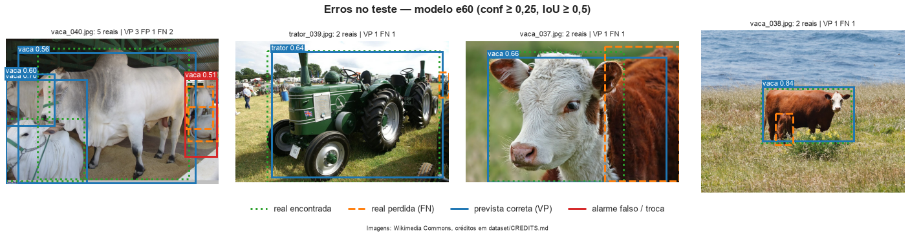 | 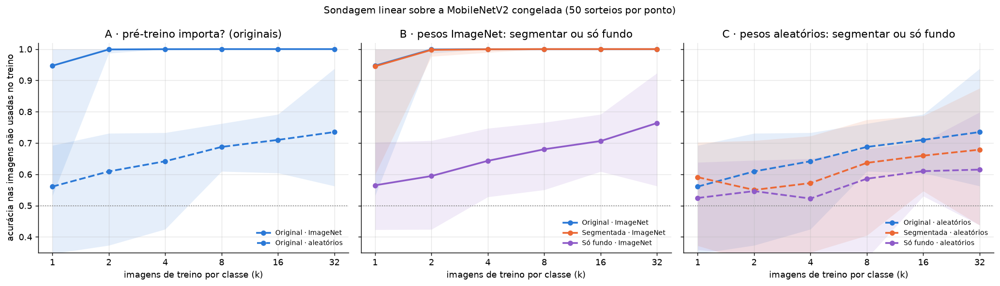 |

## Limitações

- Teste com 8 imagens e val+teste com 16: cada imagem vale 12,5 pontos percentuais no teste, e empates de uma imagem não apontam vencedor.
- Dataset da web, com o objeto centralizado, sem imagens vazias nem distratores (caminhões, cavalos, outras máquinas): as métricas são um teto otimista do desempenho em campo.
- A validação escolheu o `best.pt` do YOLO customizado e guiou o *early stopping* da CNN, o que deixa as métricas em val+teste otimistas para essas duas abordagens.
- A segmentação do Ir Além usa modelos pré-treinados grandes e teria de rodar em produção sobre cada imagem nova.
- Próximo passo: algumas centenas de fotos das câmeras reais do cliente, com rebanhos densos e cenas sem objetos.

## Extra: desafio vaca × cavalo

Vaca e trator são visualmente muito diferentes, então não confundir os dois prova pouco. Para testar essa limitação, repetimos as mesmas abordagens das Entregas 1, 2 e do Ir Além num par difícil e útil para o campo: **vaca × cavalo**, dois animais fotografados no mesmo tipo de pasto. Foram 40 fotos novas de cavalos, com licença aberta e rótulos YOLO, na mesma divisão 32/4/4.

| Abordagem | vaca × trator | vaca × cavalo |
|---|---|---|
| YOLO customizado, mAP50 no teste | 0,809 | 0,885 |
| YOLO customizado e YOLO COCO, acerto por imagem (val+teste) | 100% e 93,8% | 100% e 100% |
| CNN do zero, validação cruzada (80 imagens) | 83,8% | 55,0% |
| MobileNetV2 com fine tuning, validação cruzada (80 imagens) | 100% | 90,0% |

- **A dificuldade derruba os classificadores pequenos, não os detectores.** A CNN do zero cai para perto do acaso (teste exato de Fisher, p < 0,001), e o Grad-CAM mostra que ela olha para o céu e a grama. Os dois YOLO seguem sem trocar vaca por cavalo, porque o pré-treino no COCO já separa `cow` de `horse`.
- **O pré-treino vale mais quando as classes se parecem.** A diferença de erros entre MobileNetV2 e CNN do zero sobe de 0 × 13 para 8 × 36.
- **O atalho do cenário some, mas o enquadramento continua.** "Só o fundo" ainda acerta cerca de 70%, mas em vaca × cavalo a posição do retângulo explica isso sozinha, porque as fotos de cavalo são enquadradas de outro jeito.

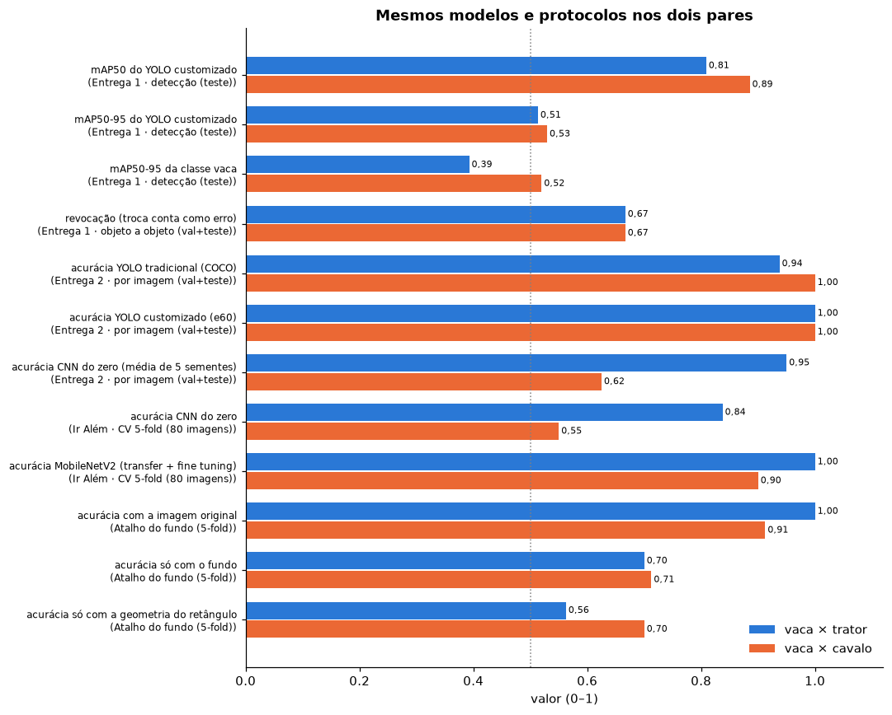

| Grad-CAM da CNN do zero | Atalho do fundo |
|---|---|
| 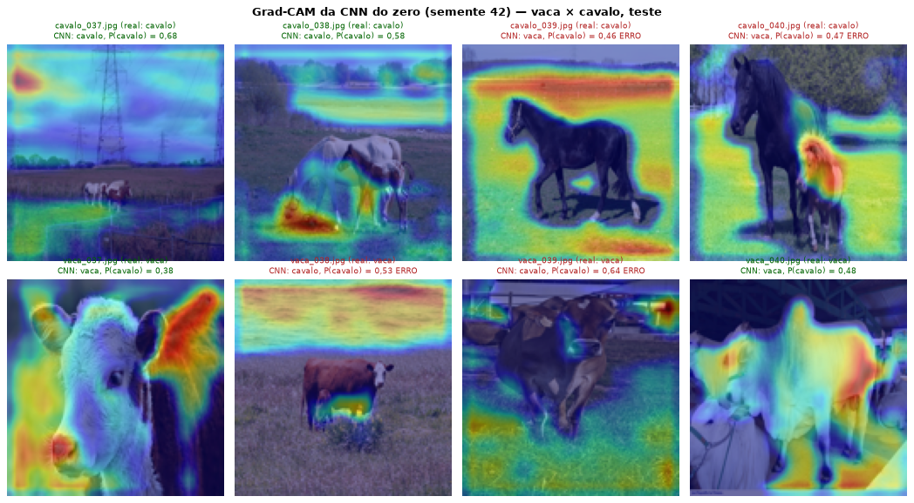 | 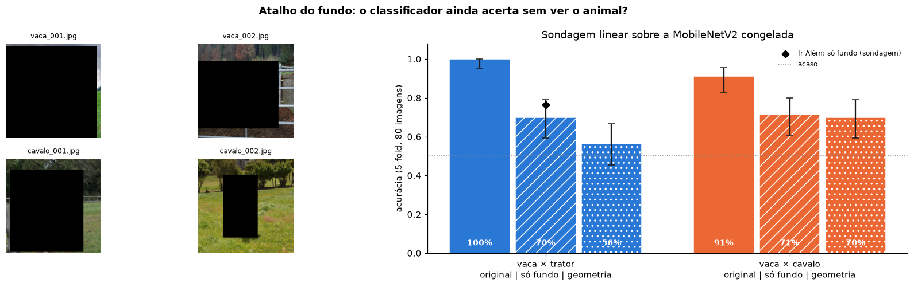 |

Análise completa: [`extra/extra_vaca_cavalo.ipynb`](extra/extra_vaca_cavalo.ipynb) · [](https://colab.research.google.com/github/leticiael/leticiaeltermann-fiap-fase6-visao-computacional/blob/main/extra/extra_vaca_cavalo.ipynb). Créditos das fotos de cavalo em [`extra/dataset_cavalo/CREDITS.md`](extra/dataset_cavalo/CREDITS.md).

## Vídeos de demonstração

| Vídeo | Link |
|-------|------|
| Entregas 1 e 2 (até 5 min) | `<LINK_YOUTUBE_ENTREGAS>` |
| Ir Além (até 5 min) | `<LINK_YOUTUBE_IR_ALEM>` |

## Evidências do processo

Prints de cada etapa, tirados durante a execução real do projeto.

### 1. Organização no Google Drive

| Pastas do projeto | Divisão treino, validação e teste | Imagens de treino |
|---|---|---|
| 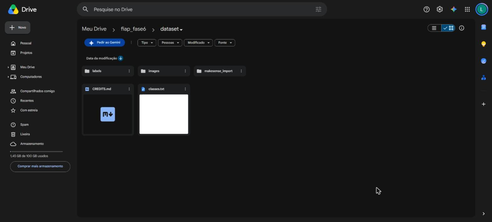 | 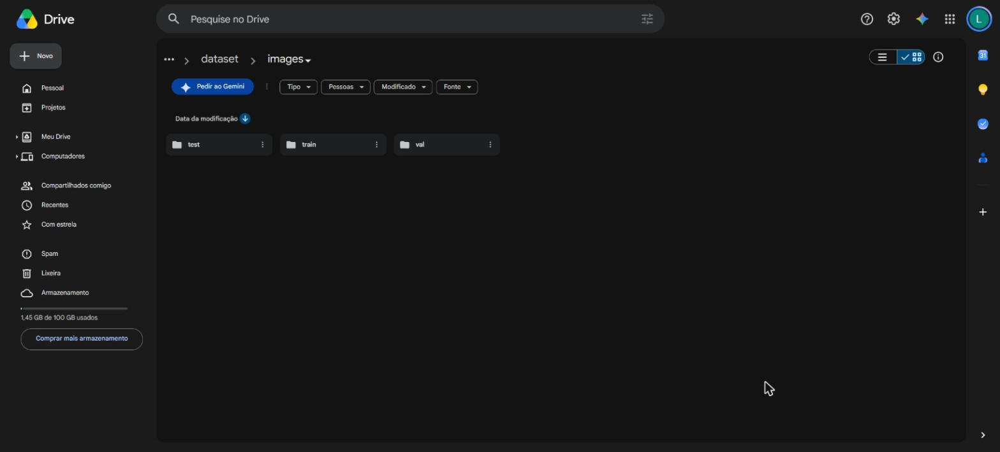 | 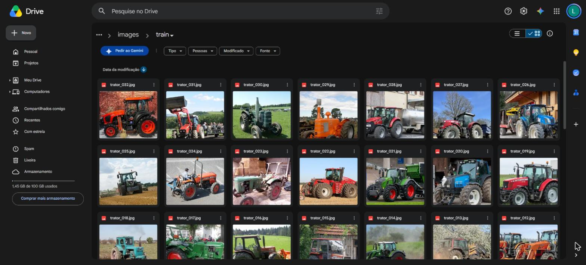 |

### 2. Rotulação no Make Sense

| 80 imagens carregadas | Classes vaca e trator | Vacas rotuladas |
|---|---|---|
| 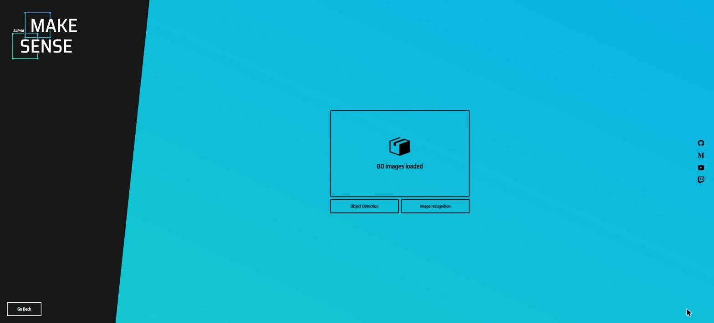 | 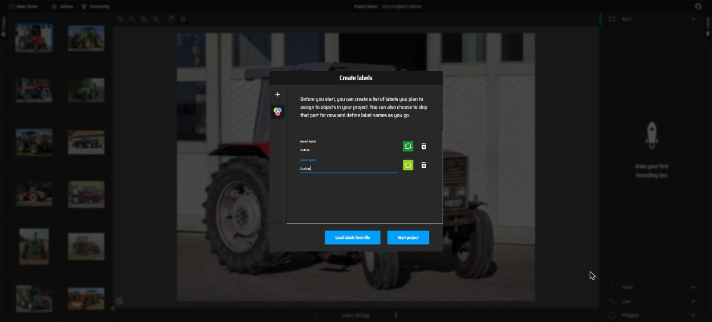 | 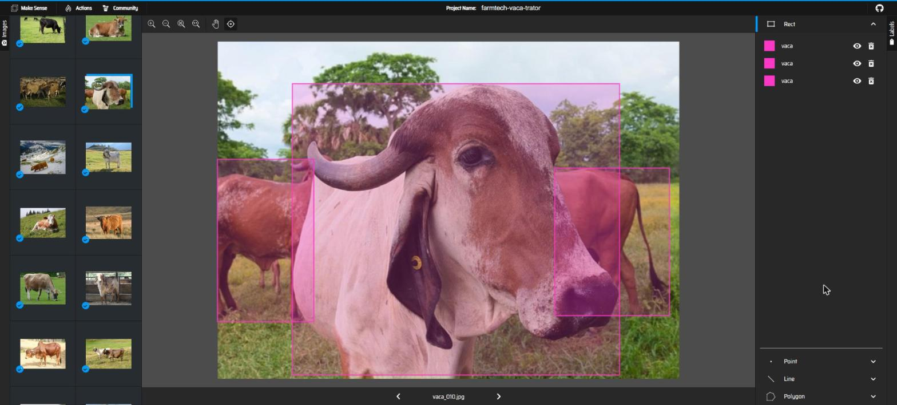 |

| Trator rotulado | Ajuste manual: segundo trator ao fundo | Exportação em formato YOLO |
|---|---|---|
| 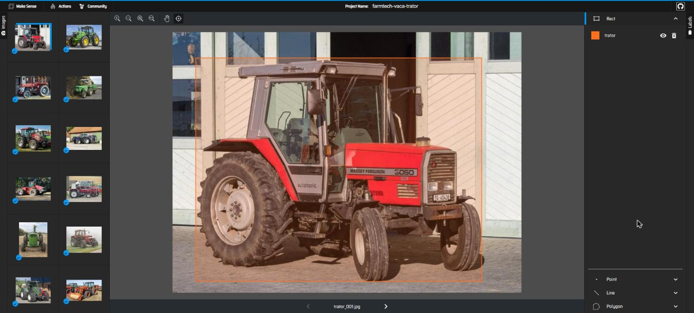 | 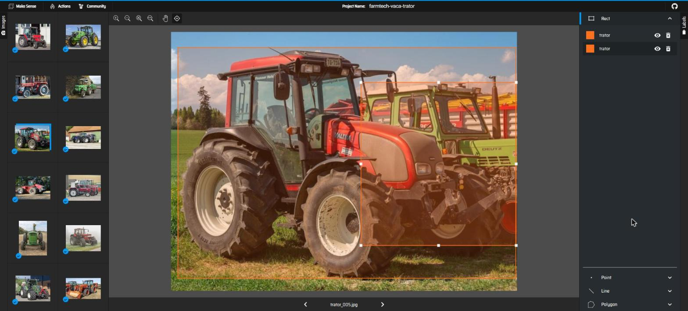 | 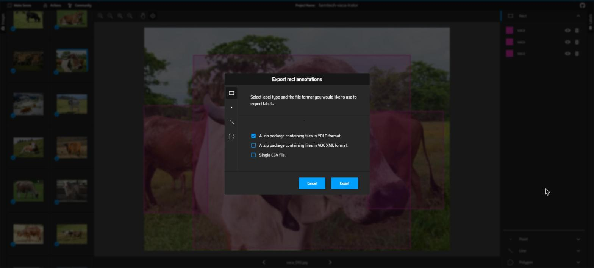 |

### 3. Treino no Google Colab conectado ao Drive

| Drive montado no Colab | GPU ativa | Treino concluído | Resultados salvos |
|---|---|---|---|
| 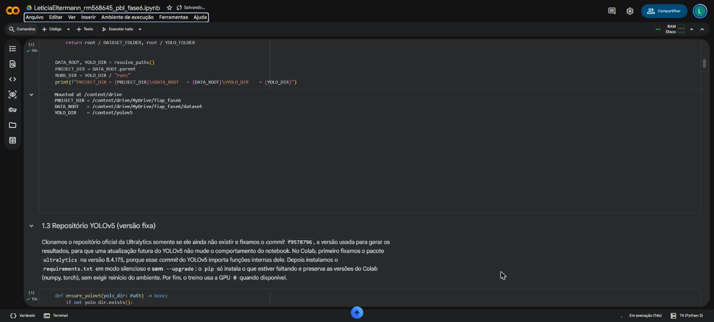 | 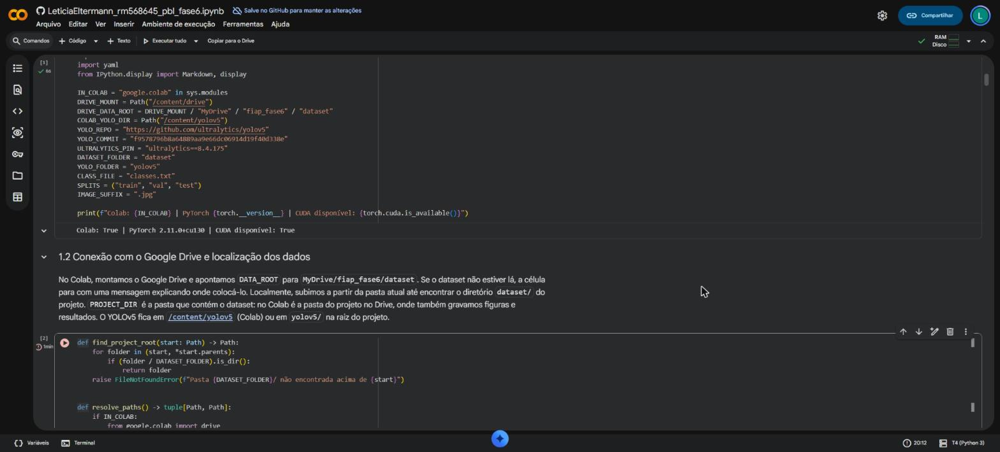 | 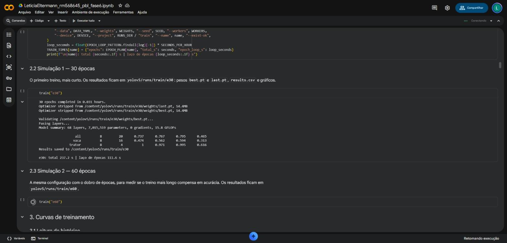 | 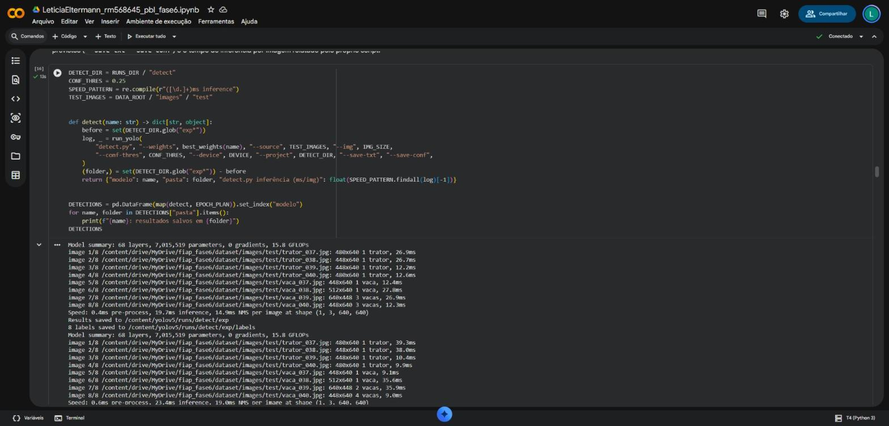 |

## Estrutura do repositório

```
.
├── README.md
├── requirements.txt
├── LeticiaEltermann_rm568645_pbl_fase6.ipynb      notebook principal (Entregas 1 e 2)
├── dataset/
│   ├── images/{train,val,test}/              32 / 4 / 4 imagens por classe
│   ├── labels/{train,val,test}/              rótulos no formato YOLO
│   ├── classes.txt                           0 vaca | 1 trator
│   └── CREDITS.md                            origem e licença de cada imagem
├── ir_alem/
│   ├── ir_alem_transfer_segmentacao.ipynb
│   ├── dataset_segmentado/                   imagens recortadas e máscaras
│   └── figuras/                              figuras e tabelas geradas pelo notebook
├── extra/
│   ├── extra_vaca_cavalo.ipynb               desafio vaca × cavalo
│   ├── dataset_cavalo/                       40 cavalos, rótulos YOLO e créditos
│   └── figuras/
└── docs/
    ├── figuras/                              arquitetura e figuras exportadas do notebook principal
    ├── prints/                               evidências de Drive, Make Sense e Colab
    ├── roteiro_video_entregas.md
    └── roteiro_video_ir_alem.md
```

## Como executar

### Google Colab (recomendado)

1. Copie a pasta `dataset/` deste repositório para o seu Google Drive, mantendo este caminho:

   ```
   MyDrive/
   └── fiap_fase6/
       └── dataset/
           ├── images/{train,val,test}/
           ├── labels/{train,val,test}/
           └── classes.txt
   ```

2. Abra o notebook pelo badge **Open in Colab** na seção [Onde está cada coisa](#onde-está-cada-coisa).
3. Ative a GPU em *Ambiente de execução > Alterar o tipo de ambiente de execução > GPU*.
4. Execute *Ambiente de execução > Executar tudo* e autorize o acesso ao Drive quando solicitado.

### Execução local

Requer Python 3.10 a 3.12 e, de preferência, GPU com CUDA.

```bash
git clone https://github.com/leticiael/leticiaeltermann-fiap-fase6-visao-computacional.git
cd leticiaeltermann-fiap-fase6-visao-computacional
python -m venv .venv
.venv\Scripts\activate
pip install -r requirements.txt
jupyter notebook
```

No Linux/macOS, ative a venv com `source .venv/bin/activate`. O notebook clona o YOLOv5 na versão fixada; as dependências locais vêm do `requirements.txt`. Fora do Colab, os notebooks usam a pasta `dataset/` local no lugar do Drive.

## Dataset e créditos

As 80 imagens (40 de vacas e 40 de tratores) vêm do Wikimedia Commons, sob licenças CC BY, CC BY-SA ou domínio público, e foram rotuladas no [Make Sense](https://www.makesense.ai/). Autoria, fonte e licença de cada arquivo estão em [`dataset/CREDITS.md`](dataset/CREDITS.md). As imagens mantêm as licenças originais, independentes do código deste repositório.

## Tecnologias

- Python, Jupyter e Google Colab (GPU)
- [YOLOv5](https://github.com/ultralytics/yolov5) (Ultralytics) com PyTorch
- TensorFlow/Keras (CNN do zero e MobileNetV2)
- YOLO-World + SAM 2 para a segmentação do Ir Além
- Make Sense para a rotulação
- Matplotlib, Pandas e OpenCV para análise e visualização
