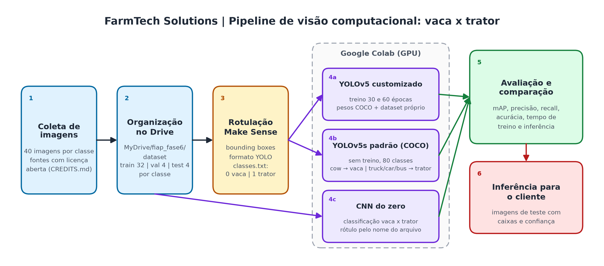
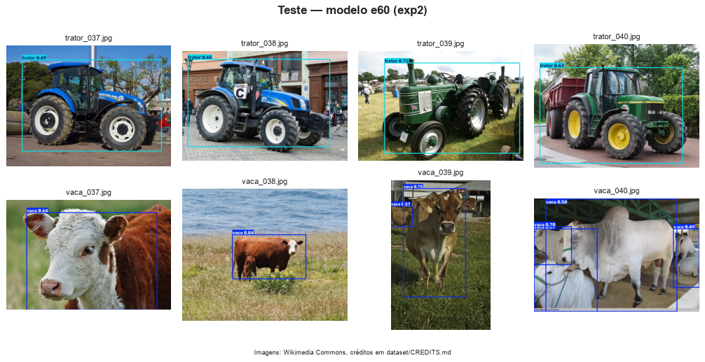

# FarmTech Solutions: visão computacional para o campo (vaca x trator)

**FIAP | Inteligência Artificial | Fase 6 | Projeto PBL**

| Nome | RM |
|------|----|
| Leticia Eltermann | 568645 |

## Contexto

A FarmTech Solutions está ampliando seus serviços de IA para a área de visão computacional. Este repositório reúne a prova de conceito apresentada a um cliente do agronegócio: um detector de objetos que reconhece **vacas** e **tratores** em imagens do campo, treinado com YOLOv5 em um dataset próprio e comparado com outras abordagens.



## Onde está cada coisa

Todo o desenvolvimento, as análises e as conclusões estão **nos notebooks**. Este README só indica o caminho.



| Entrega | Conteúdo | Abrir |
|---------|----------|-------|
| Entregas 1 e 2 | Dataset, rotulação, YOLOv5 customizado (30 e 60 épocas), YOLOv5s padrão (COCO), CNN do zero e comparação | [Notebook principal](LeticiaEltermann_rm568645_pbl_fase6.ipynb) · [](https://colab.research.google.com/github/leticiael/leticiaeltermann-fiap-fase6-visao-computacional/blob/main/LeticiaEltermann_rm568645_pbl_fase6.ipynb) |
| Ir Além (opção 2) | Transfer learning com MobileNetV2 + fine tuning e segmentação automática para remover o fundo antes da classificação | [Notebook Ir Além](ir_alem/ir_alem_transfer_segmentacao.ipynb) · [](https://colab.research.google.com/github/leticiael/leticiaeltermann-fiap-fase6-visao-computacional/blob/main/ir_alem/ir_alem_transfer_segmentacao.ipynb) |

## Vídeos de demonstração

| Vídeo | Link |
|-------|------|
| Entregas 1 e 2 (até 5 min) | `<LINK_YOUTUBE_ENTREGAS>` |
| Ir Além (até 5 min) | `<LINK_YOUTUBE_IR_ALEM>` |

## Estrutura do repositório

```
.
├── README.md
├── requirements.txt
├── LeticiaEltermann_rm568645_pbl_fase6.ipynb      notebook principal (Entregas 1 e 2)
├── dataset/
│   ├── images/{train,val,test}/              32 / 4 / 4 imagens por classe
│   ├── labels/{train,val,test}/              rótulos no formato YOLO
│   ├── classes.txt                           0 vaca | 1 trator
│   └── CREDITS.md                            origem e licença de cada imagem
├── ir_alem/
│   ├── ir_alem_transfer_segmentacao.ipynb
│   ├── dataset_segmentado/                   imagens recortadas e máscaras
│   └── figuras/
└── docs/
    ├── figuras/                              arquitetura e prints de resultados
    ├── roteiro_video_entregas.md
    └── roteiro_video_ir_alem.md
```

## Como executar

### Google Colab (recomendado)

1. Copie a pasta `dataset/` deste repositório para o seu Google Drive, mantendo este caminho:

   ```
   MyDrive/
   └── fiap_fase6/
       └── dataset/
           ├── images/{train,val,test}/
           ├── labels/{train,val,test}/
           └── classes.txt
   ```

2. Abra o notebook pelo badge **Open in Colab** acima.
3. Ative a GPU em *Ambiente de execução > Alterar o tipo de ambiente de execução > GPU*.
4. Execute *Ambiente de execução > Executar tudo* e autorize o acesso ao Drive quando solicitado.

### Execução local

Requer Python 3.10 a 3.12 e, de preferência, GPU com CUDA.

```bash
git clone https://github.com/leticiael/leticiaeltermann-fiap-fase6-visao-computacional.git
cd leticiaeltermann-fiap-fase6-visao-computacional
python -m venv .venv
.venv\Scripts\activate
pip install -r requirements.txt
jupyter notebook
```

No Linux/macOS, ative a venv com `source .venv/bin/activate`. O notebook clona o YOLOv5 na versão fixada; as dependências locais vêm do `requirements.txt`. Fora do Colab, os notebooks usam a pasta `dataset/` local no lugar do Drive.

## Ir Além

A opção 2 do Ir Além está em [`ir_alem/`](ir_alem/). O pipeline segmenta automaticamente o objeto principal (caixas do YOLO-World refinadas em máscara pelo SAM 2), aplica uma máscara sobre o fundo e só então classifica a imagem com uma MobileNetV2 pré-treinada ajustada por fine tuning. O diagrama do pipeline e os resultados ficam em [`ir_alem/figuras/`](ir_alem/figuras/).

## Dataset e créditos

As 80 imagens (40 de vacas e 40 de tratores) vêm do Wikimedia Commons, sob licenças CC BY, CC BY-SA ou domínio público, e foram rotuladas no [Make Sense](https://www.makesense.ai/). Autoria, fonte e licença de cada arquivo estão em [`dataset/CREDITS.md`](dataset/CREDITS.md). As imagens mantêm as licenças originais, independentes do código deste repositório.

## Tecnologias

- Python, Jupyter e Google Colab (GPU)
- [YOLOv5](https://github.com/ultralytics/yolov5) (Ultralytics) com PyTorch
- TensorFlow/Keras (CNN do zero e MobileNetV2)
- YOLO-World + SAM 2 para a segmentação do Ir Além
- Make Sense para a rotulação
- Matplotlib, Pandas e OpenCV para análise e visualização
